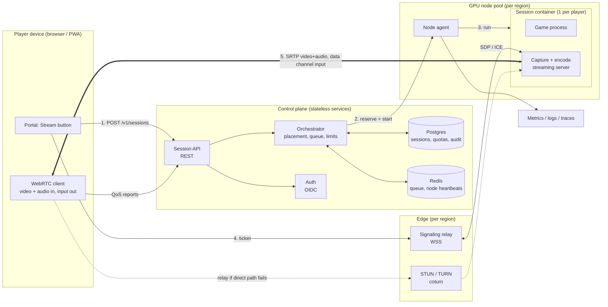
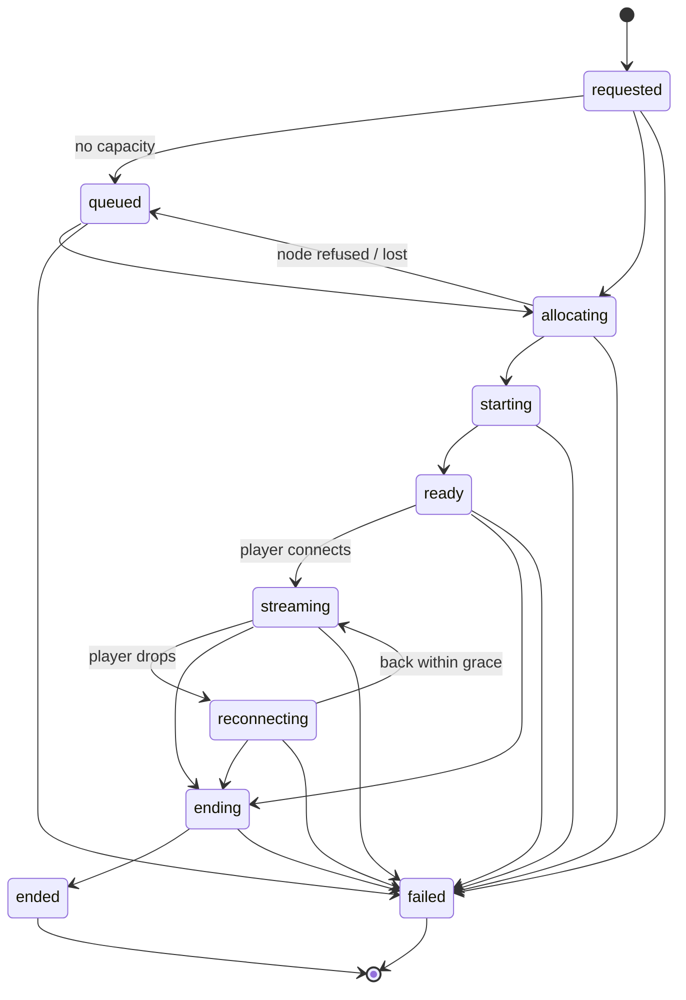
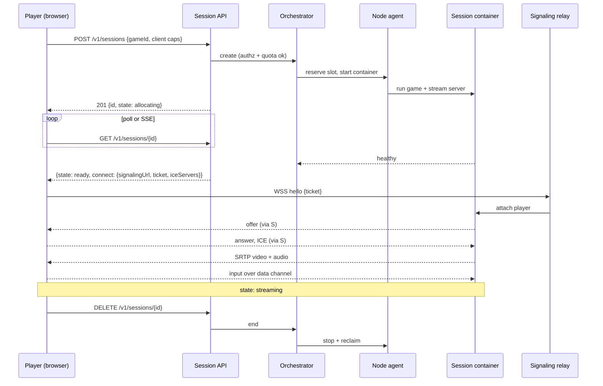

# GameForge cloud streaming - architecture

**Status: design only. Nothing in this document is built.** The only code that exists for it is the
typed session contract in [`streaming/contracts/session.ts`](../../streaming/contracts/session.ts)
and its tests. Everything that is a measurement or a vendor fact says where it came from; anything
else is a target, an assumption or an open question, and is labelled as one.

The goal is "play a game on any device while it runs on a server" - the Xbox Cloud Gaming model.

---

## 1. Decide first: is streaming the right delivery mode for a title?

GameForge already has a cheaper way to reach any device: **browser-hosted play**
([PR #2](https://github.com/onegayunicorn/gameforge-portal/pull/2)). The game is built to static
files, published under `pwa/play/<id>/`, and runs on the player's own device.

| | Browser-hosted play (exists) | Cloud streaming (this document) |
|---|---|---|
| Where the game runs | Player's device | A GPU server |
| What is sent | The game, once (hello-render is 85 KB) | Video + audio, continuously |
| Cost per player-hour | About zero (static hosting) | GPU share + egress (see section 9) |
| Latency | None added | Network round trip + encode + decode |
| Works offline | Yes (service worker) | No |
| Needs a server fleet | No | Yes |
| Can run native / heavy titles | No - web only | Yes |
| Content stays off the device | No | Yes |

Every game the engine builds today is a Canvas2D browser game. **Streaming one of them would add
latency and cost and give the player nothing.** It earns its keep only for titles that

1. are **native binaries** (Windows/Linux executables, Unity/Unreal exports) that cannot run in a
   browser at all, or
2. are **too heavy** for the target devices (WebGL2 scenes on low-end phones), or
3. must **not be delivered to the device** (unreleased builds, licensed content with a no-download
   clause).

So the portal should choose the delivery mode **per title** (section 11) and default to the browser.
If no planned title meets any of the three conditions above, the right answer is to not build this.

---

## 2. Goals, non-goals and targets

**Goals**
- A player on a phone, tablet, laptop or TV browser opens the portal, presses **Stream**, and is
  playing within ~15 seconds on a warm pool, with a gamepad, keyboard/mouse or touch controls.
- Many players share a GPU fleet; sessions are isolated from each other and from the host.
- A forgotten or crashed session never holds a GPU (every state has a timeout, see the contract).

**Non-goals (for now)**
- Streaming third-party commercial games. That needs publisher agreements; Xbox Cloud Gaming has
  them, this project does not. Only titles the project owns or is licensed to stream.
- Consoles, anti-cheat-protected titles, VR, multi-GPU single sessions.
- Replacing the Electron desktop app or the browser-hosted route.

**Targets (planning numbers, not measurements - Phase 0 exists to replace them with real ones)**

| Metric | Target | Why |
|---|---|---|
| Player-to-server round trip | <= 40 ms | Leaves room in the budget below |
| Input-to-photon (glass-to-glass) | <= 100 ms median, <= 150 ms p95 | Commonly cited comfort range for action games |
| Video | 1080p60, H.264 baseline; HEVC/AV1 where the client has hardware decode | H.264 decodes in hardware almost everywhere |
| Bitrate | 10-20 Mbps at 1080p60; 3-5 Mbps at 720p30 | Typical range; encoder and content dependent |
| Session start (warm pool) | <= 15 s to first frame | Includes container start |
| Session start (cold node) | <= 90 s | Matches `SESSION_LIMITS.startTimeoutMs` |

**Latency budget** (what the 100 ms has to cover; all values are planning estimates):

| Stage | Budget |
|---|---|
| Input capture and send (client) | 1-8 ms |
| Network, client to server | 0.5 x RTT (about 15-20 ms at 40 ms RTT) |
| Game simulation + render (one frame at 60 fps) | 17 ms |
| Capture + hardware encode | 3-8 ms |
| Network, server to client | 0.5 x RTT |
| Jitter buffer | 0-20 ms |
| Decode | 2-10 ms |
| Display (scan-out) | 8-16 ms |

---

## 3. System overview

Design principles
1. **The control plane never touches media.** Video flows only between the player and the session
   container, directly or via TURN. The control plane can fall over without dropping a live stream.
2. **One session = one container = one player.** The container is the isolation, accounting and
   cleanup boundary.
3. **Everything has a deadline.** Queue, start, ready, reconnect, idle and total duration each have
   a timeout (`SESSION_LIMITS`); reclaiming a GPU never depends on a client behaving.
4. **Adopt, don't build, the media path.** Capture, encode, congestion control and the browser
   client are the hard, well-trodden part. Build the control plane around an existing stack.

---

## 4. Components

| Component | Responsibility | Notes |
|---|---|---|
| **Web client** | Stream button, WebRTC peer, input capture (keyboard, pointer lock, Gamepad API, touch overlay), QoS reporting, reconnect | Extends the existing portal/PWA. Needs `connect-src` extended to the signaling origin (the portal CSP is currently `connect-src 'self'`). |
| **Session API** | `POST/GET/DELETE /v1/sessions`, authz, quota checks, idempotency keys | Contract in `streaming/contracts/session.ts`. Stateless. |
| **Orchestrator** | Placement (region, GPU type, free slots), queueing, state machine, timeouts, reconciliation with node reality | Owns the session state machine. Reconciles on a loop so a lost node is detected, not assumed. |
| **Node agent** | Per GPU host: reports capacity and health, starts/stops session containers, enforces limits locally | Heartbeats to Redis. Refuses work when unhealthy. |
| **Session container** | The game, a virtual display/audio, the capture + encode + transport server | Rootless, no host network, GPU via device plugin, read-only base image, ephemeral storage, egress allow-list. |
| **Signaling relay** | WebSocket relay of SDP/ICE between client and the right container; validates the single-use ticket | Per region. Holds no media. |
| **STUN / TURN** | NAT traversal and media relay fallback | coturn with ephemeral, time-limited credentials minted per session. Needs UDP and TCP/TLS 443 for restrictive networks. |
| **Auth** | Sign-in and tokens | OIDC provider; the API accepts short-lived access tokens only. |
| **Observability** | Metrics, logs, traces, session timeline | See section 10. |

### Session lifecycle

State machine (encoded and tested in `streaming/contracts/session.ts`):

Happy path, with what crosses each boundary:

---

## 5. Choosing the media stack

Facts below were read from each project's GitHub README on 2026-10-14. **I have not run any of them
against this repository**; fit is decided in Phase 0.

| | Selkies | Sunshine + Moonlight | Wolf (Games on Whales) |
|---|---|---|---|
| What it is | Linux GPU-accelerated HTML5 remote desktop / game streaming | Self-hosted game-stream host; Moonlight is the client | Streaming server for Moonlight that shares one host between several clients using containerised apps |
| License | MPL-2.0 | GPL-3.0 | MIT |
| Browser client | **Yes** - the client is a web page | **No** - needs a Moonlight client app | No - Moonlight clients |
| Transport | WebSockets by default; WebRTC is opt-in | Moonlight/GameStream protocol | Moonlight protocol |
| GPU | NVIDIA, AMD, Intel | Encoders listed: NVENC, AMF, QuickSync, VAAPI, Vulkan Video, software | Multiple GPUs; can encode on one and render on another |
| Input | Keyboard, mouse, gamepad; mic and webcam forwarding | Via Moonlight | Via Moonlight |
| Multi-session on one host | Deployable per container (Docker, Kubernetes) | Not stated in what I read | Yes - the point of the project |
| Maintenance (from README) | Active; asks for more maintainers | Not stated in what I read | Active; documented, tested C++ codebase |

How this maps to our needs:
- "Any device, nothing to install" needs a **browser client**, which points to **Selkies** (or a
  WebRTC server we write ourselves - not recommended). Because it defaults to WebSockets, **WebRTC
  mode must be tested for latency**; the WebSocket path is not an acceptable default for action games
  if it adds head-of-line blocking (to be measured, not assumed).
- Native clients (TVs, consoles, Steam Deck, phones with the Moonlight app) fit **Wolf**
  (multi-tenant, MIT) rather than Sunshine alone.
- **GPL-3.0 (Sunshine) is fine as a separate service we run** and talk to over its interface. Do not
  link or vendor it into this repository. Keep the license boundary clear.

**Recommendation:** Phase 0 spikes **Selkies in WebRTC mode** for the browser path and **Wolf** for the
native-client path, on the same host and same test game, and picks by measured glass-to-glass
latency, start time and operability. The control plane in this document is independent of which
wins - it only needs "start a container, get a health signal, hand the player a signaling URL".

If neither fits, the fallback is **GStreamer + webrtcbin (or Pion) directly**, accepting the
engineering cost of owning capture, pacing and congestion control.

---

## 6. Interfaces

The full types live in `streaming/contracts/session.ts`. Summary:

**REST (control plane)**

| Method and path | Purpose | Notes |
|---|---|---|
| `POST /v1/sessions` | Request a session | Body: game id, region hint, client capabilities (resolution, bitrate, codecs, gamepad, touch). Idempotency key header. Returns a `SessionView`. |
| `GET /v1/sessions/{id}` | Poll state | While `queued` includes `queuePosition`; in `ready`/`streaming`/`reconnecting` includes `connect`. |
| `DELETE /v1/sessions/{id}` | End | Idempotent. |
| `POST /v1/sessions/{id}/qos` | Client quality report ~1 Hz | `QosReport` |
| `GET /v1/games?delivery=stream` | Streamable catalogue | Backed by the games index (section 11). |

**Signaling (WebSocket, JSON):** `hello{ticket}` -> `welcome` -> server `offer` -> client `answer` +
`ice` both ways -> `bye`. Errors carry a code (`bad_ticket`, `bad_message`, or a session error).

**Input:** an unordered, unreliable WebRTC data channel (a lost key-down is better than a stale one).
Each event carries a `seq` (drop old/reordered) and a client timestamp (latency measurement only).
Key *releases* and gamepad full-state snapshots are repeated so a lost packet cannot leave a key stuck.
The server rate-limits and validates every field.

**Ticket:** single-use, bound to one session and one user, expires in seconds, delivered only in the
`ready` response over TLS.

---

## 7. Security and abuse

| Threat | Mitigation |
|---|---|
| Stolen or replayed connect ticket | Single use, short expiry, bound to session + user, verified by the signaling relay |
| Abuse of TURN as an open relay | Ephemeral per-session credentials (HMAC over expiry, shared secret with coturn), deny relaying to private/loopback ranges, per-credential bandwidth cap |
| Escape from the game container | Rootless runtime, seccomp/AppArmor, dropped capabilities, no host network or host PID, no Docker socket, read-only root FS, per-session ephemeral volume. Treat a game as hostile code |
| Cross-session data access | One container per session; no shared writable volume; storage wiped on `ended` |
| Egress abuse (crypto mining, spam, DDoS from the GPU) | Default-deny egress with an allow-list per title; CPU/GPU quotas and a watchdog |
| Input injection / flooding | Validate and rate-limit input events server-side; allow-list key codes; clipboard and file transfer **off** by default |
| Quota exhaustion / queue starvation | Per-user concurrent session limit, per-tier max duration, queue timeouts, fair queuing |
| GPU held forever by a dead session | Every state has a timeout; reconciliation loop compares the database with what each node reports |
| Privacy | Do not record sessions or input by default; log session metadata and QoS, not content; define retention before launch |
| Content licensing | Only titles flagged `streamable` in the catalogue; licence recorded per title |

A formal threat model (STRIDE over the diagram in section 3) is a **Phase 1 exit requirement**, not a
nice-to-have, because the session container runs untrusted code on shared hardware.

---

## 8. Scaling and placement

- **Regions:** place by measured RTT to the player, not geography. Start with one region; add more
  only when the p95 RTT of real players justifies it.
- **Placement:** the orchestrator picks a node with a free slot in the player's region, matching GPU
  class to the title's declared requirements. Bin-pack to keep whole nodes free for scale-down.
- **Warm pool:** keep N idle, pre-pulled slots per region so start time is container start, not image
  pull. N follows demand history.
- **Queueing:** when full, queue with a visible position and an estimate; time out at
  `SESSION_LIMITS.queueTimeoutMs` with a clear message.
- **Density per GPU:** unknown until measured. It depends on the game, the encoder, and any
  **vendor/driver limit on concurrent hardware-encode sessions - check the limit for the chosen GPU
  and driver before sizing anything.**
- **Node loss:** the orchestrator marks sessions on a silent node `failed` with code `node_lost`; the
  player is offered a new session. Mid-session migration is out of scope (it cannot preserve game
  state).

---

## 9. Cost model

Per player-hour: `gpu_cost = node_price_per_hour / sessions_per_node / utilisation`, plus
`egress = Mbps x 0.45 GB-per-Mbps-hour x price_per_GB`.

Egress arithmetic that does not depend on any price: **15 Mbps is 6.75 GB per hour per stream**
(15,000,000 bit/s x 3,600 s / 8).

Illustrative only - **every input here is a placeholder to be replaced with real quotes and Phase 0
measurements**: a node at $1.00/h, 4 sessions per node, 60% utilisation gives ~$0.42 per player-hour
for GPU, and 6.75 GB at $0.05/GB adds ~$0.34, so ~$0.75 per player-hour. At those placeholder inputs
a free tier is very expensive and the per-title decision in section 1 matters a great deal.

Levers: lower default bitrate/resolution, AV1/HEVC where the client supports it, session caps, idle
timeouts, spot capacity for non-latency-critical pools, and not streaming titles that run fine in a
browser.

---

## 10. Observability and SLOs

Collected from the client (`QosReport`, ~1 Hz) and the node:

- Network: RTT, jitter, packet loss, bitrate, relayed vs direct path
- Media: fps, resolution, decode time p95, dropped frames, encode time, encoder queue depth
- Input: input-to-display latency (round-trip probe), event rate
- Platform: time in each session state, start success rate, queue wait, node utilisation, GPU
  temperature and encoder load, orphaned-session count

Proposed SLOs (to confirm after Phase 1): 99% of session requests reach `ready` or a clear `queued`
within 10 s; 95% of started sessions reach first frame within the start budget; median input-to-photon
within target for players under 40 ms RTT; zero GPUs held by `ended`/`failed` sessions beyond 2 minutes.

Alert on the leading indicators first: orphaned sessions, start failures, queue wait, relay ratio.

---

## 11. How this fits the existing repository

Additive; the Electron app and browser-hosted play are not touched.

1. **Per-title delivery.** Add `delivery: ["browser"]` (default) or `["browser", "stream"]` /
   `["stream"]` to `game.config.json` and the games index. `stream` is allowed only with a recorded
   licence and a declared GPU class. The validator rejects `["stream"]` without them.
2. **Portal.** The Games card shows **Play** (browser, today) and, where `delivery` includes `stream`,
   **Stream**. A title that is stream-only shows only **Stream**, with a note that it needs a
   connection.
3. **New top-level `streaming/`** for the contract now and the services later. It deploys separately
   from the static site (Pages cannot host it) and shares no runtime code with the engine.
4. **CSP.** The signaling origin is added to the portal's `connect-src` only when streaming is
   enabled.
5. **Related material reviewed:** `gamerbay.zip` is a separate monorepo with a browser arcade app, a
   WebGL2 display engine and Gamepad/BLE controller code. It contains **no streaming components**
   (its `services/` tier is absent) and its Terraform/Kubernetes files are descriptors that its own
   documentation says were never deployed. It is not a foundation for this work. Its Gamepad/BLE
   input code may be reusable in the client later; that is unevaluated.

---

## 12. Phased plan with exit criteria

| Phase | Scope | Exit criteria (measured) |
|---|---|---|
| **0 - Spike** (1-2 weeks, one GPU host) | One session, hand-started. Selkies (WebRTC mode) and Wolf+Moonlight, same game, same host | Glass-to-glass latency measured on a real network at 1080p60 (median and p95); first-frame time; CPU/GPU load; a written pick of stack and the **sessions-per-GPU** number |
| **1 - Private alpha** | Auth, session API, orchestrator with the real state machine, node agent, signaling, coturn, one region, <= 10 invited users | Threat model done and reviewed; all session states exercised including failure injection (kill container, kill node, drop network); no orphaned GPU after 100 randomised sessions; SLO dashboards live |
| **2 - Multi-host** | Scheduler across several nodes, warm pool, queueing, quotas, autoscaling | Load test at 2x expected concurrency holds the start SLO; scale-down reclaims empty nodes; cost per player-hour measured, not estimated |
| **3 - Multi-region, public** | Latency-based placement, ops runbooks, support tooling, billing/limits per tier | Meets the section 2 targets for 95% of players in served regions; incident runbooks exercised; legal/licensing sign-off per streamed title |

**Stop condition:** if Phase 0 shows median glass-to-glass above ~150 ms on a good network, or no
stack gives a usable sessions-per-GPU, do not proceed - stay with browser-hosted play.

---

## 13. Open questions and risks

1. Is there a single planned title that actually needs streaming (section 1)? If not, this is premature.
2. Selkies WebRTC-mode latency and gamepad behaviour on iOS Safari, Android Chrome and desktop
   browsers: **unverified**. iOS browser limits (fullscreen, Gamepad API, autoplay of audio) must be
   tested on devices, not assumed.
3. Vendor encoder session limits and GPU licensing terms for data-centre use of consumer GPUs:
   **unverified; check before buying or renting hardware.**
4. Which licensed titles, and does each licence allow cloud delivery?
5. Where do saves live and how are they migrated between sessions and nodes?
6. Audio: Opus over WebRTC is standard, but A/V sync and the browser autoplay unlock policy need a
   client-side design.
7. Accessibility: remappable input, captions, and reduced-latency modes are not designed yet.
8. Operating model: who is on call for a GPU fleet?
